# Языки программирования
## Лабораторная работа 5

### Задание 1 **(2)**
*Переведите в двоичную запись два произвольных рациональных числа (числа вида* $\frac{p}{q}$).
*У одного из чисел знаменатель должен быть степенью двойки (32), а у другого --- некоторым числом
от 9 до 12.*

*Запись второго числа будет содержать период. Его надо найти. При решении задачи нельзя 
использовать вычислительную технику. Процесс решения должен быть представлен в отчете.*

**Ответ.**

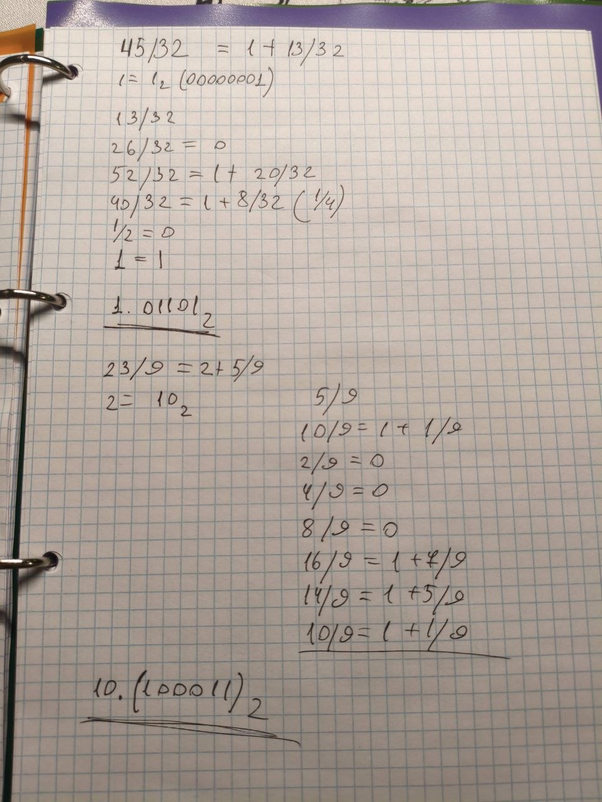

**Итог:** 45/32 = 1.01101, 23/9 = 10.(100011)

### Задание 2 **(3)**
*Переведите в двоичную запись и найдите машинное представление в типе* **double**
*для произвольного вещественного числа большего, чем 100 с одним знаком после точки, например
для* $113.7$. *Цифра после точки не должна быть нулем иля пятеркой.*

*При решении задачи нельзя 
использовать вычислительную технику. Процесс решения должен быть представлен в отчете.*


**Ответ.**

Число 107.3

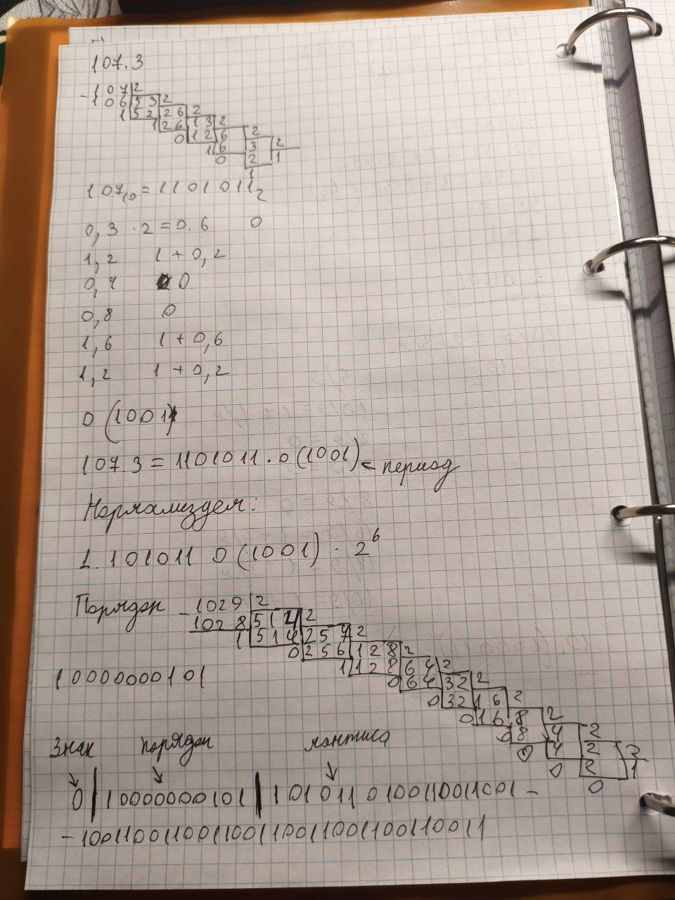

```
0 10000000101 1010110100110011001100110011001100110011001100110011
```

### Задание 3 **(3)**
*Найдите сумму и произведение для записанных далее пар чисел. Числа заданы в двоичной записи 
в экспоненциальном виде. Ответ необходимо записать в нормализованннои экспоненциальном виде.*

* 1.0011e18 и $1.1001e21;
* 1.1011e-25 и, $1.1101e-23;
* 1.1011e-3 и $1.1011e1.
  
*При решении задачи нельзя 
использовать вычислительную технику. Процесс решения должен быть представлен в отчете.*

**Ответ.**

**Пара 1 1.0011e18 и 1.1001e21**

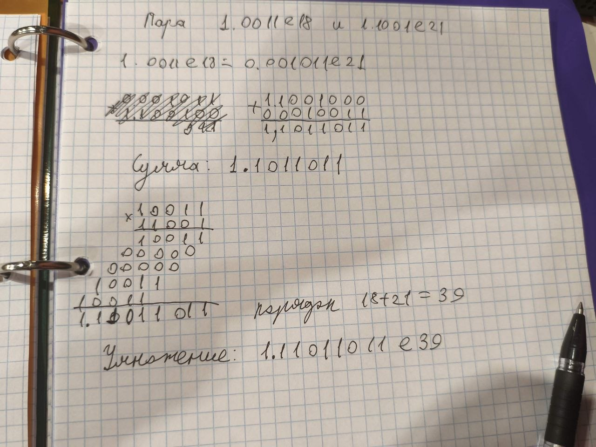

Сумма 1.1011011e21
Произведение 1.11011011e39

**Пара 2 1.1011e-25 и 1.1101e-23**

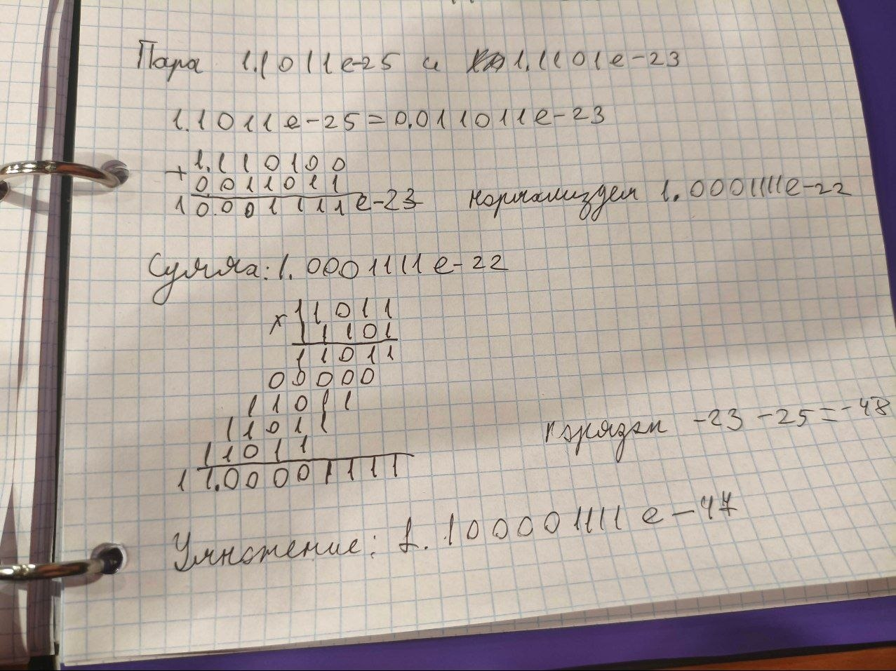

Сумма 1.0001111e-22  
Произведение 1.100001111e-47

**Пара 3: 1.1011e-3 и 1.1011e1**

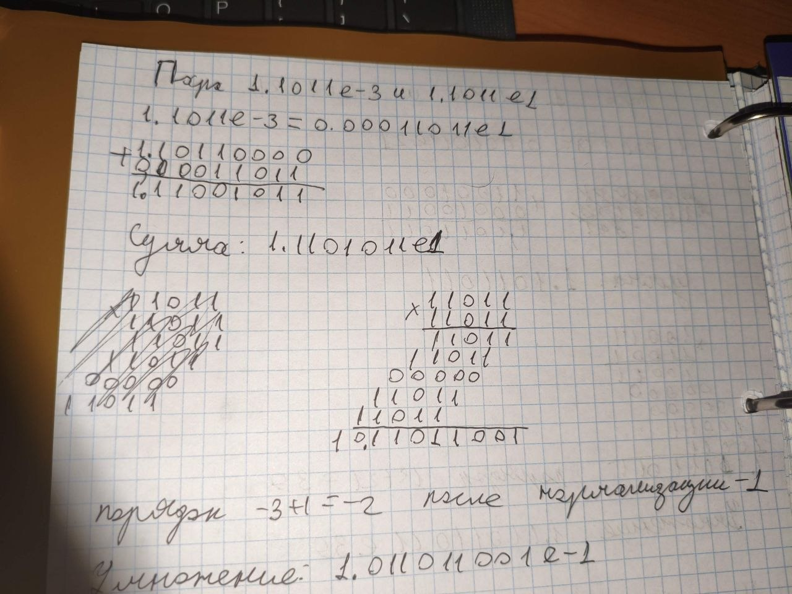

Сумма 1.11001011e1  
Произведение 1.011011001e-1


### Задание 4 **(2)**

*Рассмотрим следующий пример в IDLE Python*
```
>>> x = 99.99
>>> int(x/10+0.001)
9
```
*Результат должен был быть равен 10, однако оказался другим. Почему так произошло?
Как исправить программу, чтобы она корректно переводила вещественные числа в целые?*

**Ответ.**

Причина в том, что 99.99 нельзя записать в двоичной системе точно. В двоичной записи это бесконечная периодическая дробь, а в памяти хранится только 52 цифры мантиссы, поэтому записывается ближайшее число, и оно отличается от 99.99.

Вычисления по порядку:

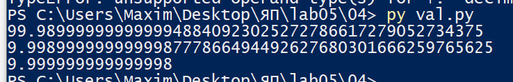

Число 0.001 тоже хранится с небольшой погрешностью.

Функция int не округляет, а отбрасывает дробную часть. Поэтому 9.999999999999998 превращается в 9, а не в 10.

Как исправить: для перевода вещественного числа в целое надо использовать округление round, а не int:

```
x = 99.99
print(round(x/10 + 0.001))
```

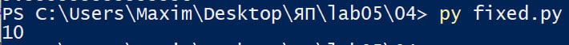

round берёт ближайшее целое число. Число 9.999999999999998 ближе к 10, чем к 9. Добавлять 0.001 не обязательно, так как функция round все равно превратит результат в 10.

### Задание 5. **(2)**

*Рассмотрите следующую программу. Объясните результаты ее работы. В частности,
как величина* $y$ *повлияла на ответ?*
```
x = 1/3
y = 1
for i in range(20):
    print((x+y)-y)
    y*=10
```
*В отчете требуется привести вычисления для оценки погрешности.*


**Ответ.**

Программа складывает x = 1/3 и y, а потом сразу вычитает y обратно. Если бы числа хранились точно, каждый раз выводилось бы 1/3 = 0.3333..., но на каждом шаге число растет в 10 раз и погрешность тоже растет в 10 раз.  
Вот что выводит программа:

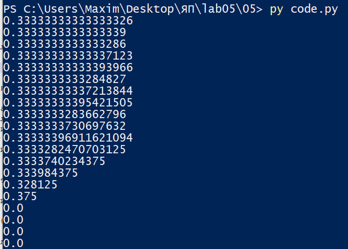

Чем больше y, тем больше порядок суммы x + y, а значит, тем крупнее шаг, с которым эта сумма записывается: 2^(p-52). Цифры числа x, которые мельче этого шага, теряются при сложении и после вычитания y не возвращаются.

### Задание 6 **(2)**

*Для какого минимального значения* $n$ *программа на С++ выведет* **inf**? *Объясните
ответ.* *Что произойдет, если тип* **double** *заменить на* **long double**?
```
int n=...;
double s = pow(2, n);
std::cout << std::fixed << s << std::endl;
```

**Ответ.**
Для double программа выведет inf при n = 1024.  

```g++
#include <cmath>
#include <iostream>

int main(){
int n=1024;
double s = pow(2, n);
std::cout << std::fixed << s << std::endl;
}
```

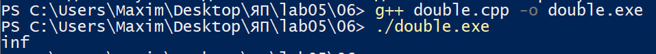

 Для long double это произойдёт при n = 16384
 ```g++
 #include <cmath>
#include <iostream>

int main(){
int n=16384;
long double s = pow(2, n);
std::cout << std::fixed << s << std::endl;
}
```
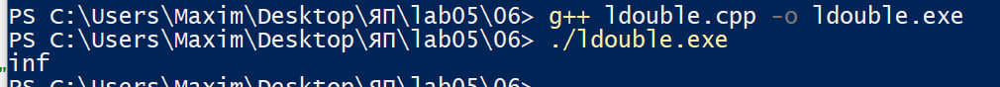

Для double нам нужен порядок 2047, то есть 2047-1023=1024, при котором будет переполнение и получится inf.

У long double набиольший порядок 32766-16383=16383, то есть на 16384 уже произойдет переполнение и получится inf.

### Задание 7 **(2)**

*Допишите что-либо вместо многоточия программе на С++, чтобы программа при запуске выдавала ответ* **yes**.
```
double s = ...;
if (s != s)
  std::cout << "yes";
```

**Ответ.**

```
double s = 0.0 / 0.0;
```

```
#include <iostream>

int main(){
	double s = 0.0/0.0;
	std::cout << s << std::endl;
	if (s != s)
		std::cout << "yes";
}
```

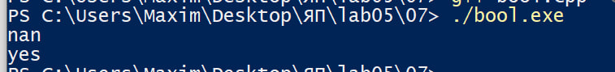


При 0.0 / 0.0 у нас получается nan, а он не равен даже самому себе, из-за чего программа выдаст yes.

### Задание 8 **(2)**

*Какое минимальное натуральное число при преобразовании в тип* **double** *записывается с погрешностью? Объясните
ответ. Почему следующее за ним число уже выводится без погрешности?*

**Ответ.** 2^53 + 1 = 9007199254740993. В double оно запишется как 9007199254740992.

В мантиссе double 52 цифры после точки. Число в двоичной записи после первой единицы содержит столько цифр, каков его порядок. Если порядок не больше 52, все цифры помещаются, и натуральное число записывается точно. Так будет для всех чисел меньше 2^53.
Для чисел от 2^53 до 2^54 порядок равен 53. После первой единицы нужно 53 цифры, а помещается 52. Теряется последняя цифра, то есть младший бит числа.
Число 2^53 это единица и 53 нуля. Последняя цифра 0, терять нечего, число записывается точно. Следующее число 2^53 + 1 это единица, 52 нуля и единица. Последняя цифра 1 теряется, и число превращается в 2^53. Значит, 2^53 + 1 это первое натуральное число, которое записывается с погрешностью (она равна 1).
Следующее число 2^53 + 2 заканчивается на 10. Последняя цифра 0, теряется ничего, число записывается точно и выводится без погрешности. Так происходит со всеми чётными числами в этом диапазоне: у них последний бит равен 0. Нечётные записываются с погрешностью 1.
###  Задание 9 **(2)**
*Напишите программу для решения следующей задачи.*

*Даны четыре рациональных числа. (Рациональное число - это число вида*
$\frac{p}{q}$, *где* $p$ *и* $q$ - *целые числа.) Напишите программу, которая сравнит сумму
двух первых чисел с суммой двух последних чисел. Программа должна выводить* $1$, $0$ *или* $-1$
*в зависимости от результатов сравнения. Решение можно проверить в проверяющей системе*
[http://olymp3.isu.ru/cgi-bin/new-client?contest_id=102](http://olymp3.isu.ru/cgi-bin/new-client?contest_id=102), *задача 03*.


Вот короткий вариант для задания 9, он заменяет прежний.

---

**Ответ.**

Делить нельзя: при делении получаются вещественные числа с погрешностью, и сравнение может соврать. Поэтому работаем только с целыми числами, как советуют на лекции (правило пропорции).

1. Сумма двух дробей: `p1/q1 + p2/q2 = (p1·q2 + p2·q1) / (q1·q2)`. Левую сумму обозначим `a/b`, правую `c/d`.
2. Чтобы сравнить `a/b` и `c/d`, умножаем обе части на `b` и `d`. Остаётся сравнить целые числа `a·d` и `c·b`.
3. Это верно, если знаменатели положительные. Если знаменатель отрицательный, меняем знак у числителя и знаменателя.

```python
p1, q1, p2, q2, p3, q3, p4, q4 = map(int, input().split())

a = p1 * q2 + p2 * q1
b = q1 * q2
c = p3 * q4 + p4 * q3
d = q3 * q4

if b < 0:
    a, b = -a, -b
if d < 0:
    c, d = -c, -d

left = a * d
right = c * b

if left > right:
    print(1)
elif left < right:
    print(-1)
else:
    print(0)
```

## Решение заданий на Python

### Задание 1

```python
value = int(input())

print(value // 15 * 15, value % 15)
```

### Задание 2

```python
value = int(input())

lenght = int(len(str(value)) / 2)

print((value // 10**lenght) + (value % 10**lenght))

```

### Задание 3

```python
value = int(input())

print(round(value / 3, 3))
```

### Задание 4

```python
price = float(input())
rub = int(price)
cop = round((price - rub) * 100)

print(rub, "rub", cop, "kop")
```

### Задание 5

```python
n, m, c, k = map(int, input().split())

sheets_needed = max(0, n * m - k)
packs_needed = (sheets_needed + 199) // 200

print(packs_needed * c)
```

### Задание 6

```python
n, m, k = map(int, input().split())

total= n * m

boxes = (total + k - 1) // k

print(boxes)
```

### Задание 7

```python
n_str, t_str = input().split()

n = int(n_str)

t = float(t_str)

val = (n * 60) / t

ans = int(val)

if val > ans:
    ans += 1

print(ans)
```

### Задание 8

```python
x, y = map(float, input().split())

start = int(x) + (x > int(x))

end = int(y) - (y < int(y))

ans = max(0, end - start + 1)

print(ans)
```

### Задание 9

```python
s = input()
total_sum = 0

for char in s:
    if char.isdigit(): 
        total_sum += int(char)

print(total_sum)
```

### Задание 10

```python
s = input()
result = ""

for char in s[::-1]:
  if char == "(":
    result += ")"
  else:
    result += "("

print(result)
```

### Задание 11

```python
words = input().split()

for word in words:
    print(word[::-1], end=' ')
```

### Задание 12

```python
def min_div(n):
  for i in range(2, n + 1):
    if n % i == 0:
      return i


numbers = map(int, input().split())

for num in numbers:
    print(min_div(num), end=' ')
```

### Задание 13

```python
n = int(input())

sum = 0
for i in range(1, int(n**0.5) + 1):
  if n % i == 0:
    sum += i
    paired = n // i
    if paired != i and paired < n:
      sum += paired

print(sum)
```

### Задание 14

```python
n = int(input())
masha = 0
dasha = 0

for _ in range(n):
  car = int(input())
  if car % 3 == 0:
    masha += 2
  else:
    dasha += 1

print(f"{masha}:{dasha}")
```

### Задание 15

```python
n = int(input())
res = 0
for i in range(n):
  income, price = map(int, input().split())

  if(income - price > 0):
      res = res + income - price

print(res)
```
