# Языки программирования
## Лабораторная работа 6

### Задание 1 **(3)**
*Рассмотрим следующую программу на С++.*
```
#include <iostream>
#include <cmath>
int main() {
   double x = 0;
   const auto Pi = std::acos(0) * 2;
   std::cout << Pi << std::endl;
   return 0;
}
```
*Проверьте четыре способа объявления* **Pi**.
* ```const auto Pi = acos(0) * 2;```
* ```constexpr auto Pi = std::acos(0) * 2;```
* ```const auto Pi = acos(x) * 2;```
* ```constexpr auto Pi = std::acos(x) * 2;```

*Что можно сказать об этих вариантах? Проверьте, в каких вариантах объявляется константа этапа трасляции.*

**Ответ.**

1. const auto Pi = std::acos(0) * 2; - значение вычисляется во время выполнения, но после инициализации переменную нельзя менять.

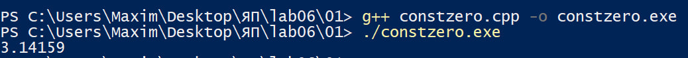

2. constexpr auto Pi = std::acos(0) * 2; - в стандартном C++17 это обычно не компилируется, поскольку std::acos не является constexpr-функцией, но из-за библиотеки libstdc++ у меня он компилируется и работает из-за дополнительной поддержки вычислений на этапе трансляции.

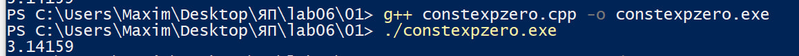

3. const auto Pi = std::acos(x) * 2; - константный объект, значение зависит от x и вычисляется во время выполнения.

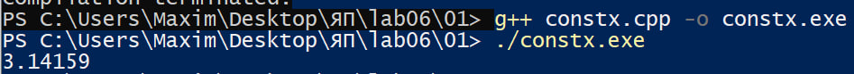

4. constexpr auto Pi = std::acos(x) * 2; - не компилируется, потому что выражение не является константным выражением, x не является константой этапа трансляции.

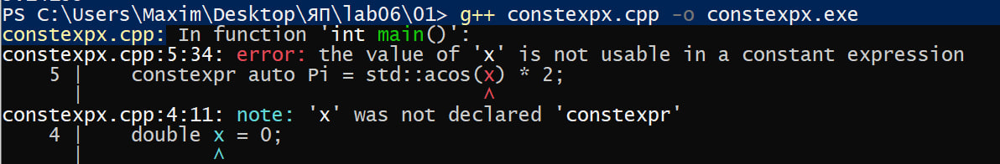


### Задание 2 **(2)**
*Проверьте работу следующей программы на С++*
```
#include <iostream>
int main() {
   {
      int x, y;
      std::cin >> x >> y;
      std::cout << x+y << std::endl;
   }
   {
      double x, y;
      std::cin >> x >> y;
      std::cout << x+y << std::endl;
   }
   return 0;
}
```
*Нужны ли в этой программе вложенные фигурные скобки? Дайте подробный ответ с объяснением причин.*

**Ответ.**

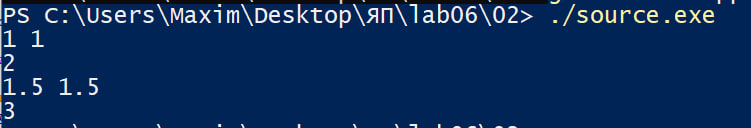

В данном варианте скобки нужны: переменные x и y объявляются сначала как int, а затем как double. В C++ нельзя объявить две переменные с одинаковыми именами в одной области видимости. Каждый вложенный блок создаёт свою область видимости, поэтому после завершения первого блока его x и y перестают быть доступны, а во втором блоке можно объявить переменные с такими же именами, но другого типа. Если убрать блоки, нужно будет переименовать переменные.

```g++
#include <iostream>
int main() {
   {
      int x, y;
      std::cin >> x >> y;
      std::cout << x+y << std::endl;
   
      double x, y;
      std::cin >> x >> y;
      std::cout << x+y << std::endl;
   }
   return 0;
}
```

Вот что будет если убрать фигурные скобки:

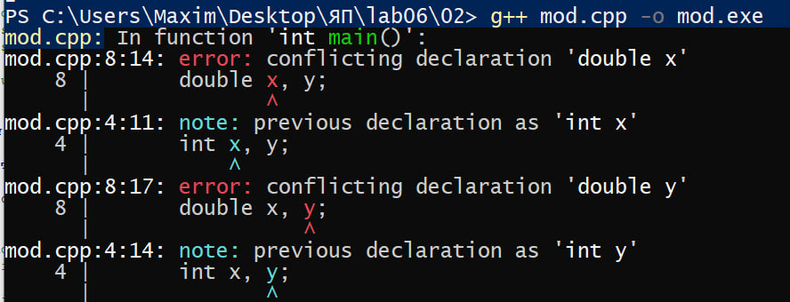

### Задание 3 **(2)**
*Проверьте работу следующего фрагмента программы на С++.*
```
int s = 0;
for (int i = 0; i < 4; i++) {
   for (int i = 0; i < 3; i++) {
      s += i;
   } 
   s += i; 
}
std::cout << s;
```
*В результате каких вычислений был получен ответ? Дайте подробный ответ.*

**Ответ.**

Результат программы 18. Внутренний цикл у нас при каждой итерации добавляет 3, таких прохода 4, то есть 12. Внешний цикл у нас работает 4 раза и добавляет 0+1+2+3, то есть 6. Получается 12+6

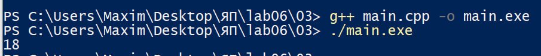
### Задание 4 **(2)**

*Проверьте работу следующего фрагмента программы на* **Python**.
```
s = 0
for i in range(4):
   for i in range(3):
      s += i
   s += i
print(s)
```
*В результате каких вычислений был получен ответ? Дайте подробный ответ.*

*На основе этих примеров поясните различия между* **С++** и **Python** *при работе с переменными*.

**Ответ.**

В C++ переменная, объявленная внутри блока или во внутреннем цикле, имеет область видимости этого блока. Поэтому внутренний i затеняет внешний только внутри своего блока. В python такого нет, из-за чего вычисления идут так: начинается внешний цикл, потом прогоняется внутренний цикл, где идет 0+1+2, у переменной i запоминается последнее значение 2 и в конце итерации внешнего цикла к s добавляется 2. То есть каждую итерацию выходит 0+1+2+2, это 5, таких итераций четыре, то есть ответ 0+1+2+2+0+1+2+2+0+1+2+2+0+1+2+2=20.


### Задание 5 **(2)**

*Напишите свой пример программы на* **С++**, *создающий и использующий пространства имен. Программа
должна содержать не менее двух пространств имен.*

**Ответ.**

```cpp
#include <iostream>

namespace first {
    int value = 10;
}

namespace second {
    int value = 25;
}

int main() {
    std::cout << first::value << std::endl;
    std::cout << second::value << std::endl;
    std::cout << first::value + second::value << std::endl;
    return 0;
}
```

В обоих пространствах имён есть переменная value. Оператор :: указывает, к какому пространству имён относится имя. Программа выводит 10, 25 и 35.

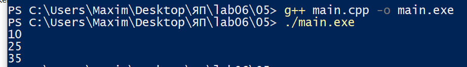

### Задание 6 **(2)**

*Рассмотрим следующий фрагмент программы. Эта программа 1000000 раз обменивает значения двух длинных 
строк с использованием третьей строки. Проверьте, насколько быстро она работает.*

```
std::string a(100000, 'a');
std::string b(100000, 'b');
for (int i=0;i<1000000;i++) {
   std::string c(a);
   a = b;
   b = c;
}
std::cout << a[0] << b[0];
```
*Попробуйте использовать для обмена значений строк функцию* **swap**. 
*Проверьте, изменилось ли время работы. В чем ошибка исходной программы?
Исправьте исходную программу, чтобы ускорить ее работу. Изменения не должны 
затрагивать общий вид программы (присваивания, использование временной переменной).*

**Ответ.**  
Время работы программы:

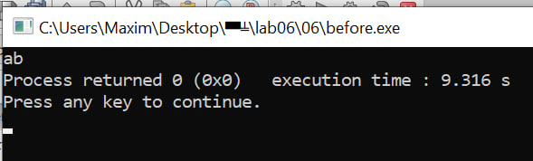

```cpp
#include <iostream>
#include <string>

int main() {
    std::string a(100000, 'a');
    std::string b(100000, 'b');

    for (int i = 0; i < 1000000; i++) {
        std::string c;
        c.swap(a);
        a.swap(b);
        b.swap(c);
    }

    std::cout << a[0] << b[0];
}
```

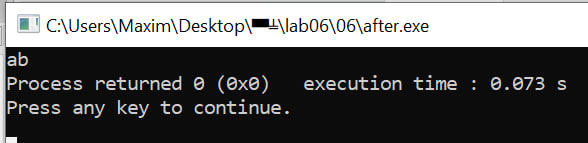

Здесь сохраняется схема обмена через временную переменную, но вместо копирующих присваиваний используется swap. Время работы меньше на 8.24 секунд, что в несколько раз быстрее. Основная неэффективность исходного кода во многократном копировании больших строк.

### Задание 7 **(2)**

*Рассмотрим программу на языке* **Python**.
```
a = 'Hello world'
print(a, id(a))
b = a
print(b, id(b))
a += ' and goodbye'
print(a, id(a))
print(b, id(b))
```
*Объясните ее работу. В какой момент создавались строки? 
Что означает значение, возвращенное функцией* **id**?

**Ответ.**

Сначала a ссылается на строку Hello world, а b = a связывает b с тем же объектом. При выполнении a +=  and goodbye строка не изменяется на её месте создаётся новая строка, и a начинает ссылаться на неё. b продолжает ссылаться на исходную строку. Поэтому b остаётся равной Hello world.

Функция id() возвращает идентификатор объекта, который позволяет проверить его идентичность в течение выполнения программы.

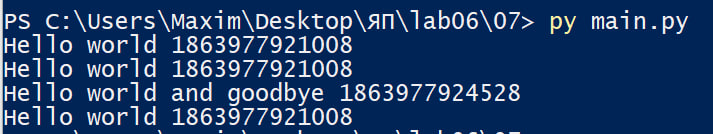
### Задание 8 **(2)**

*Пусть* **a** - *строковая переменная в программе на* **Python**.
*Есть ли разница между работой присваивания*
```b = a```
и
```b = a[:]```
*Напишите программу для демонстрации различий.*

**Ответ.**

Строки в Python неизменяемы, поэтому b = a связывает оба имени с одним объектом. Срез всей строки a[:] также обычно возвращает тот же объект, так что для строк заметного различия нет. Это отличается от списков, где a[:] создаёт поверхностную копию.

```python
a = ["Hello", "world"]
b = a
c = a[:]

print(id(a), id(b), id(c))
print(a is b)
print(a is c)
```

Срез списка a[:] создаёт новый список. Поэтому a и b ссылаются на один объект, а c — на отдельную поверхностную копию. Из-за этого id(a) == id(b), но id(c) отличается. Соответственно, a is b возвращает True, а a is c — False.

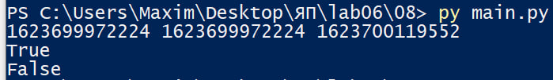

###  Задание 9 **(3)**
*Напишите программу на языке* **Python**, *которая создаст 2600 переменных с именами
от* **a0** *до* **a99**, *от* **b0** *до* **b99** *и так далее, от* **z0** *до* **z99**. 
*Присвойте всем переменным различные значения от 1 до 2600.*

**Ответ.**

```python
letters = "abcdefghijklmnopqrstuvwxyz"
value = 1

for letter in letters:
    for i in range(100):
        globals()[f"{letter}{i}"] = value
        value += 1

print(a0, a99)
print(b0, b99)
print(z0, z99)
```

globals() возвращает словарь глобальных имён текущего модуля. Два цикла создают имена от a0 до z99 и присваивают им числа от 1 до 2600. Всего создаётся 26 * 100 = 2600 переменных с различными значениями.

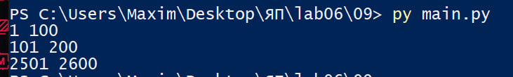
