# Языки программирования
## Лабораторная работа 7

### Задание 1 **(2)**
*Оцените работу следующих фрагментов программ. Какие из них обладают неоднозначным поведением? Почему?*
```
int x=10, y=3;
std::cout << std::min(x=15, x+y);
```
```
int x=10, y=3;
x=15, y+=x, x+=y;
```
```
int x=10, y=9;
if (x>y++ && y++>9)
  cout << "yes" << endl;
cout << y;
```

**Ответ.**

В первом фрагменте порядок вычисления аргументов std::min не определен, поэтому нельзя гарантировать один результат. Я проверил на локальном компиляторе и веб-компиляторе (стандарт C++14), ответы вышли разными.  

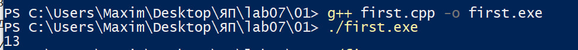

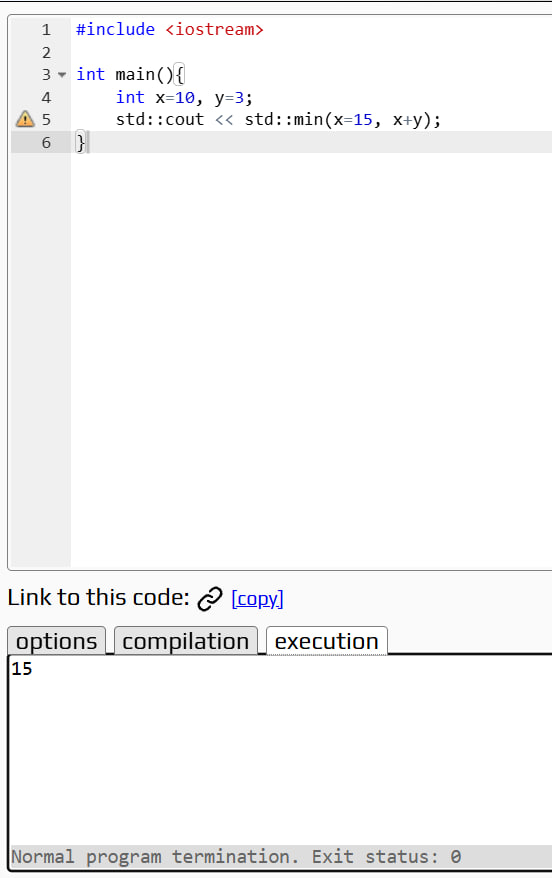

Во втором фрагменте оператор запятая задает последовательное выполнение слева направо, поэтому в конце x = 33, y = 18.  
 В третьем фрагменте оба условия истинны, поэтому программа выводит yes, затем 11.

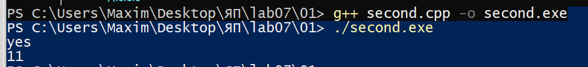
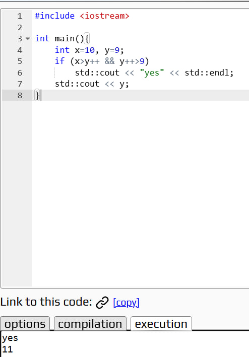

### Задание 2 **(2)**
*Как записать следующие строки программы на С++ в виде одного
выражения? Приведите несколько способов, в том числе с использованием операторов инкремента.*
*Проверьте работу написанных программ*
```
x=x+1;
z=z+2*x+3*y;
y=y+1;
```

**Ответ.**

Все действия можно объединить так (++x, z += 2*x + 3*y, ++y);.

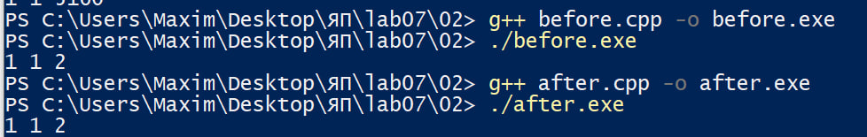


### Задание 3 **(2)**
*Рассмотрите следующий фрагмент программы. Он заполняет вектор из 10 элементов единицами.*
```
std::vector<int> x(10);
for (int i = 0; i < 10;)
   x[i++] = 1;
```
*Перепишите ее так, чтобы в третьей строке использовался префиксный инкремент, но результат ее работы не изменился.*
```
std::vector<int> x(10);
for (...)
   x[++i]=1;
```

**Ответ.**

```cpp
std::vector<int> x(10);
for (int i = -1; i < 9;)
    x[++i] = 1;
```

Переменная i начинается со значения -1, поэтому перед первой записью увеличивается до 0. Так заполняются элементы с индексами от 0 до 9. После заполнения всех десяти элементов условие цикла становится ложным.

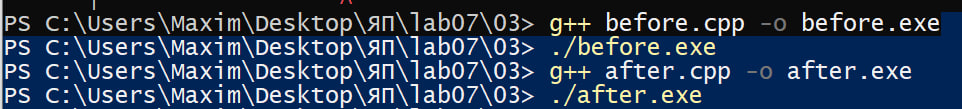

### Задание 4 **(2)**

*Почему присваивание* ```(++x)=y``` *является синтаксически правильным, а*
```(x++)=y``` - *нет? Запишите текст сообщения об ошибке, переведите и объясните его.*

**Ответ.**

Префиксный инкремент `++x` возвращает саму переменную, поэтому результат можно использовать слева от присваивания. Суффиксный инкремент `x++` возвращает временное значение, которому нельзя присвоить новое значение. Выдаст ошибку "lvalue required as left operand of assignment" (lvalue - конкректный объект в памяти, rvalue - временное значение, в нашем случае от постфиксного инкремента, присваивание требует lvalue,а получает rvalue, из-за чего и получается ошибка).

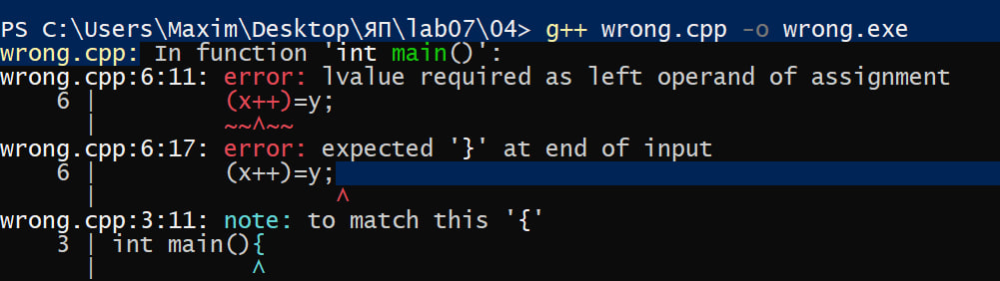

### Задание 5 **(2)**

*Программисты на Python для обмена значений двух переменных часто пишут строку*
```
a,b = b,a
```
*Проверьте, будет ли аналогичная строка на С++ (с точкой с запятой в конце) являться синтаксически
правильной? Будет ли она обменивать значения переменных? Как в языке С++ вычисляется это выражение?*

**Ответ.**

Запись a,b = b,a; в C++ синтаксически правильная, но значения не меняются местами. Она вычисляется как три выражения: a, b = b и a, соединенные оператором запятая. В b записывается его же значение. Для обмена можно использовать `std::swap(a, b);`.

```g++
#include <iostream>

int main(){
	int x = 1, b = 2;
	x, b = b, x;
	
	std::cout << x << ' ' << b;
}
```

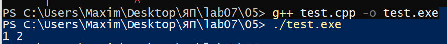

### Задание 6 **(2)**

*Проверьте работу следующего фрагмента программы*
```
  std::string s;
  for (int i=0; i<1000000; i++)
     s += 'a';
  std::cout << s.size();
```
*Измените третью строку на*
```
s=s+'a';
```
*Изменится ли что-нибудь в ее работе? Объясните результат.*

**Ответ.**

В обоих случаях программа выведет 1000000, так как символ добавляется миллион раз. При s += 'a' строка дополняется символом напрямую. Выражение s = s + 'a' обычно создает новую строку и копирует в нее старое содержимое, поэтому работает медленнее.


До изменения:  
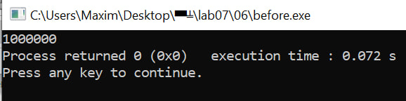

После измненеия:  
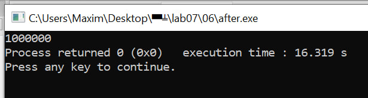

Время работы очень сильно различается, потому что как и написано выражение s = s + 'a'; создает новую строку, что замедляет работу.

### Задание 7 **(2)**

*Как работает следующая программа? Как зависит результат от исходного значения?*
```
int x;
std::cin >> x;
x-->0 && x-->0 && x-->0 && x-->0 && x-->0;
std::cout << x;
```

**Ответ.**

Запись x-->0 означает x-- > 0: старое значение сравнивается с нулем, после чего x уменьшается. Оператор && прекращает вычисления после первого ложного условия. Даже если исходное значение меньше или равно 0, то оно всё равно один раз уменьшится на 1, далее всё будет зависеть от числа, числа меньше 5 будут выдавать -1 после выполнения условий (будет пять постфиксных декрементов), 5 будет выдавать 0 (тоже пять постфиксных декрементов), числа больше 5 будут просто на 5 меньше:

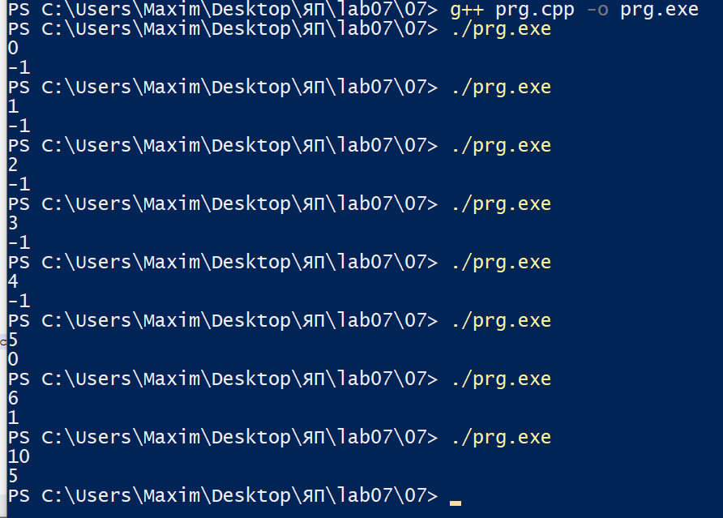

### Задание 8 **(3)**

*Какое число выводит следующий фрагмент программы? Посчитайте результат без использования
вычислительной техники. Отчет должен содержать процесс вычислений.*
```
int s = 0;
for (int i = 0, j = 5;i+j <= 16;(i<j ? i : j)++)
   (s += i) += j;
std::cout << s;
```

**Ответ.**

На каждой итерации к s прибавляется сумма i + j, затем увеличивается меньшее из двух значений. При равенстве увеличивается j. Суммы по итерациям: 5, 6, 7, 8, 9, 10, 11, 12, 13, 14, 15, 16, их сумма равна 5 + 6 + 7 + 8 + 9 + 10 + 11 + 12 + 13 + 14 + 15 + 16 = 126. После последней итерации сумма i + j становится 17, поэтому цикл завершается и программа выводит 126.

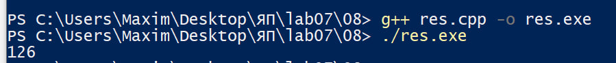

###  Задание 9 **(3)**
*Рассмотрите следующую программу. Предполагается, что на вход подается некоторый
индекс в массиве - число от нуля до девяти и значение, которое надо записать по этому индексу.*
```
int i = 0;
std::vector<int> x(10);
std::cin >> i >> x[i];
std::cout << x[i];
```
*Проверьте работу этой программы на различных компиляторах. Найдите два компилятора (можно 
проверить онлайн компиляторы), на которых эта программа будет давать различные ответы при одинаковом
вводе. Как это объяснить?*

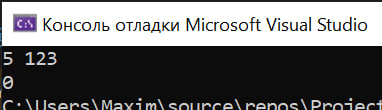

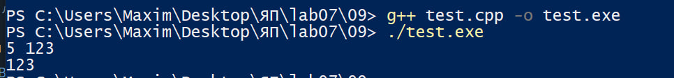

При вводе 5 123 компилятор G++ вывел 123, а Microsoft Visual Studio 2022 вывел 0. В Visual Studio сначала вычислился индекс x[i], когда i еще равнялся нулю, поэтому значение 123 записалось в x[0], а при выводе программа обратилась к x[5], который остался равен нулю. В G++ сначала выполнился ввод индекса, поэтому значение записалось в x[5] и программа вывела 123. Такое различие связано с порядком вычисления операндов перегруженного оператора >>, в Microsoft visual studio 2022 этот порядок не определен, а в g++ он определен как слева направо. 


### Решение задач на Python 3

### Задача 1

```
n = int(input())
k = (n + 24) // 25
min = n // k
print(k, min)
```


### Задача 2

```
t = int(input())

for i in range(t):
   n = int(input())

   p, q = map(int, input().split())

   bits = []
   for j in range(n):
      p *= 2
      bit = p // q
      bits.append(str(bit))
      p %= q

   print("0." + "".join(bits))
```

### Задача 3

```
t = int(input())

answers = []
for i in range(t):
    a, b, c, d, e, f, g, h = map(int, input().split())

    left_num = a * d + c * b
    left_den = b * d

    right_num = e * h + g * f
    right_den = f * h

    x = left_num * right_den
    y = right_num * left_den

    if x < y:
        answers.append("-1")
    elif x == y:
        answers.append("0")
    else:
        answers.append("1")

print(" ".join(answers))
```

### Задача 4

```
n = int(input())
numbers = input().split()

result = []
for i in range(n):
    x = int(numbers[i])

    x_bin = bin(x)[2:]
    y = len(x_bin)
    y_bin = bin(y)[2:]
    z = len(y_bin)

    code = "0" * (z - 1) + y_bin + x_bin[1:]
    result.append(code)

print("".join(result))
```

### Задача 5

```
n = int(input())
numbers = input().split()

result = []
for i in range(n):
    x = int(numbers[i])

    x_bin = bin(x)[2:]
    y = len(x_bin)
    y_bin = bin(y)[2:]
    z = len(y_bin)

    code = "0" * (z - 1) + y_bin + x_bin[1:]
    result.append(code)

print("".join(result))
```
