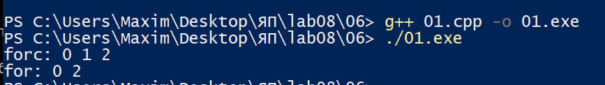
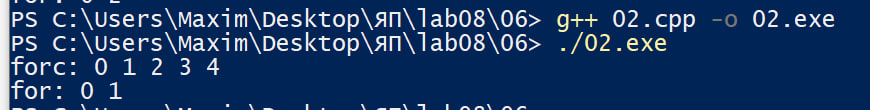
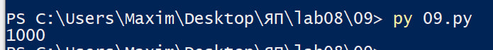

# Языки программирования
## Лабораторная работа 8

### Задание 1 **(2)**
*Рассмотрим программу на языке* **Python**.
```
x = [int(t) for t in input().split()]
for i in range(len(x)):
   if x[i] < i or x[i] > 2*i:
      break
print(i)
```
*Перепишите эту программу так, чтобы в ней использовался цикл* **while**, *в ней не использовалась
инструкция* **break**, *а используемый алгоритм не изменился. Полученная программа должна иметь следующий 
вид.*
```
x = [int(t) for t in input().split()]
i = 0
while ...:
   i += 1
print(i)
```
*Допишите правильное логическое выражение вместо многоточия. Выражение не должно содержать оператор* **not**.

**Ответ:**

```
x = [int(t) for t in input().split()]
i = 0
while i < len(x) and (x[i] >= i and x[i] <= 2 * i):
   i += 1
print(i)
```

### Задание 2 **(2)**
*Рассмотрим программу на языке* **Python**.
```
x = [int(t) for t in input().split()]
for i in range(len(x)):
   if i <= x[i] < 2*i or 3*i <= x[i] < 4*i:
      break
print(i)
```
*Перепишите эту программу так, чтобы в ней использовался цикл* **while**, *в ней не использовалась
инструкция* **break**, *а используемый алгоритм не изменился. Полученная программа должна иметь следующий 
вид.*
```
x = [int(t) for t in input().split()]
i = 0
while ...:
   i += 1
print(i)
```
*Допишите правильное логическое выражение вместо многоточия. Выражение не должно содержать оператор* **not**.

**Ответ:**
```
x = [int(t) for t in input().split()]
i = 0
while i < len(x) and ((i > x[i] or x[i] >= 2*i) and (3*i > x[i] or x[i] >= 4*i)):
   i += 1
print(i)
```

### Задание 3 **(2)**

*Напишите пример программы на* **Java** *с двумя вложенными циклами и инструкцией* **break** *для выхода
из двух вложенных циклов. В качестве такой программы можно взять поиск первого нуля в двумерном массиве.*

**Ответ:**

```
public class 03 {
    public static void main(String[] args) {

        int[][] a = {
                {5, 3, 8},
                {2, 7, 0},
                {4, 0, 9}};


        found:
        for (int i = 0; i < 3; i++) {
            for (int j = 0; j < 3; j++) {
                if (a[i][j] == 0) {
                    System.out.printf("Первый ноль на позиции a[%d][%d]", i + 1, j + 1);
                    break found;
                }
            }
        }
    }
}
```

### Задание 4 **(2)**

*Рассмотрим программу на языке* **Python**.
```
a = list(range(10))
b = [a.pop() - x for x in a]
print(*b)
```
*Объясните, почему список* **b** *получился именно таким.*

**Ответ:**

Изначально список a содержит числа от 0 до 9. В цикле for x in a переменная x принимает элементы списка по порядку, а метод pop() каждый раз удаляет и возвращает последний элемент списка.

При этом список a изменяется прямо во время перебора, поэтому цикл выполняется только 5 раз:
- 9 - 0 = 9
- 8 - 1 = 7
- 7 - 2 = 5
- 6 - 3 = 3
- 5 - 4 = 1  

Таким образом, список b получается [9, 7, 5, 3, 1], и программа выводит 9 7 5 3 1.


### Задание 5 **(2)**

*Напишите программу на С++, которая прочитает натуральное число* **n**, *создаст вектор
из* **n** *элементов, прочитает значения элементов, добавит последний элемент вектора к каждому элементу 
(в том числе и к последнему), найдет и выведет количество положительных и отрицательных элементов вектора
после изменения. Из циклов в программе можно использовать только циклы по коллекции.*

**Ответ:**

```
#include <iostream>
#include <vector>

int main() {
    int n, otr = 0, pol;
    std::cin >> n;
    std::vector<int> x(n);

    for (auto num : x) {
        std::cin >> num;
    }

    int last = x[n - 1];

    for (auto num : x) {
        num += last;
        if (num < 0) {
            otr++;
        }
        else {
            pol++;
        }
    }

    std::cout << pol << ' ' << otr << std::endl;


}
```

### Задание 6 **(3)**

*Представим, что в некотором будущем стандарте* **С++** *появится конструкция*
```
forc(i, from, to)
```
*которая будет раскрываться в следующий код.*
```
{
   int __i = from, __n=to;
   for(const int &i= __i; i < __n; __i++) {
      ...
   }
}
```
*Чем эта конструкция отличается от стандартного цикла* **for**? *Укажите два основных различия.
Напишите программы для демонстрации этих различий.*

*Написанные программы сохраните в папку с номером задания.*

**Ответ:**

Конструкция forc отличается от стандартного цикла for двумя основными особенностями.

Переменная i является константной ссылкой. Поэтому внутри цикла нельзя изменить её значение вручную. В обычном for переменную-счётчик можно изменять прямо в теле цикла.



Начальное и конечное значения фиксируются перед началом цикла. Значения from и to записываются в __i и __n один раз. Поэтому изменение переменной, из которой было получено значение to, не изменит границу цикла. В обычном for условие проверяется заново на каждой итерации.



Также у forc заранее задан шаг +1, в отличие от стандартного for, где шаг можно выбрать самому.


### Задание 7 **(2)**

*Напишите программу на языке* **Python** *для проверки того, что все числа во введенной 
последовательности неотрицательные. Если в цикле будет найдено отрицательное число, цикл должен
прерваться и вывести найденное число. Если отрицательных чисел нет, то вывести некоторое сообщение об этом.*

*Программа должна использовать конструкцию* **for break else**.

*Запишите аналогичную программу на С++. Какие изменения в алгоритме решения в ней появились?. Почему?*

*Написанные программы сохраните в папку с номером задания.*

**Ответ:**

В Python после цикла можно использовать else, который выполняется, если цикл завершился без break.

В C++ такой конструкции нет, поэтому приходится использовать дополнительную логическую переменную foundNegative.

Изначально она равна false. Если находится отрицательное число, она становится true, после чего цикл прерывается. После цикла проверяется значение переменной: если оно осталось false, значит, отрицательных чисел не найдено.

Таким образом, основной алгоритм остался прежним, но в C++ потребовалась дополнительная переменная для определения способа завершения цикла.


### Задание 8 **(2)**

*Рассмотрим следующую программу.* 
```
if x>=5 and y>=-5:
   print(0):
elif x<0 or y<0:
   print(1):
else:
   print(2):
```
*Опишите множества значений при которых программа выводит 0, 1 и 2. Например,*

A={ (x,y)| x ∈ [5;∞), y ∈ [-5;∞)}

**Ответ:**

A: программа выводит 0.

Оба условия должны выполняться одновременно:

A = {(x, y) | x ≥ 5, y ≥ -5}

B: программа выводит 1.

Первое условие не выполнилось, а второе выполнилось:

B = {(x, y) | (x < 0 или y < 0) и (x < 5 или y < -5)}

C: программа выводит 2.

Не выполнилось ни первое, ни второе условие:

C = {(x, y) | 0 ≤ x < 5, y ≥ 0}

###  Задание 9 **(3)**
*Напишите программу на языке Python для решения следующей задачи.*

*Задана пронумерованная последовательность логических значений* **t(0),t(1),..,t(n)**, **t(i) ∈ {False,True}**

*Последовательность обладает следующим свойством: существует некоторое число k такое, что 
все значения* **t(0),t(1),...,t(k-1)** *равны* **False**, *а все значения* **t(k), ... , t(n)** *равны* **True**,
*то есть слева от* **k** *находятся значения* **False**, *а справа* - **True**. *Последовательность задается
функцией* **t(i)**, *которая возвращает логическое значение. Например, для тестирования эту функцию можно
задать следующим образом.*
```
def t(i):
   return i>=1000
```

*Требуется написать программу, которая найдет число* **k**. *Программа должна реализовывать алгоритм 
бинарного поиска. Диапазон поиска задается переменными* **left** и **right**. *На каждом шаге вычисляется
центр диапазона, значение в нем проверяется, после чего диапазон сокращается в два раза.*

*Алгоритм должен быть записан через цикл* **while** *и реализовывать инвариант цикла*

t(left)=False ∧ t(right)=True

```
left = -1
right = 10**18
while ...:
   mid = ...
   if t(mid):
      ...
   else:
      ...
print(...)
```
**Ответ:**

```
def t(i):
    return i >= 1000


left = -1
right = 10**18

while right - left > 1:
    mid = (left + right) // 2

    if t(mid):
        right = mid
    else:
        left = mid

print(right)
```


