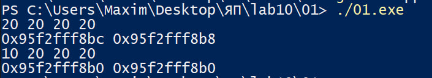
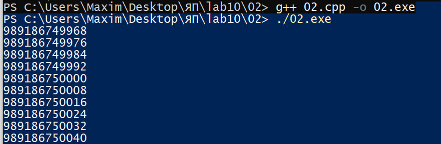
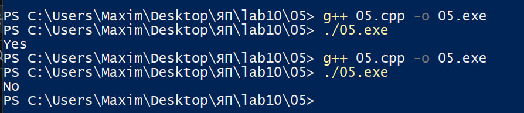
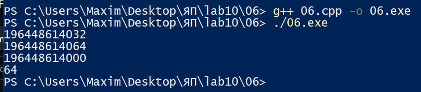
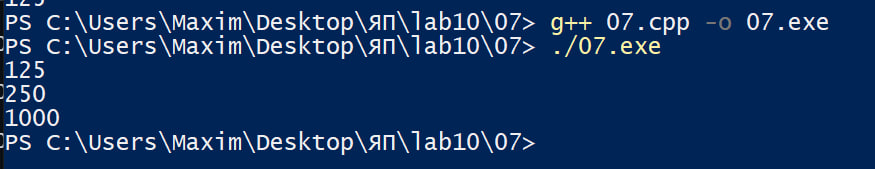

# Языки программирования
## Лабораторная работа 10

### Задание 1 **(2)**

*Рассмотрим следующие фрагменты программ.*
```
int a = 10, b = 20;
int *p = &a , *q = &b;
p = q
std::cout << *p <<' '<< *q << std::endl;
```
```
int a = 10, b = 20;
int *p = &a , *q = &b;
*p = *q
std::cout << *p <<' '<< *q << std::endl;
```
*Чем различаются присваивания в третьей строке? Что можно вывести,
чтобы показать различия?*

*Примеры программ сохраните в папке с номером задания.*

**Ответ:**  

\* - описатель указателя (при объявлении переменной), умножение, оператор разыменования (в выражении, возвращает значение по адресу из указания).  
\& - описатель ссылки (при объявлении переменной), оператор взятия адреса (в выражении). В данном случае в указатель 'p' помещается адрес 'a'.  
Адрес - идентификатор ячейки данных, некоторое число, которое является адресом в ячейке памяти.  

```
#include <iostream>

int main() {
    int a = 10, b = 20;
    int *p = &a, *q = &b;
    *p = *q;
    std::cout << a << ' ' << b << ' ' << *p << ' ' << *q << std::endl;
    std::cout << p << ' ' << q << std::endl;

    int c = 10, d = 20;
    int *r = &c, *s = &d;
    r = s;
    std::cout << c << ' ' << d << ' ' << *r << ' ' << *s << std::endl;
    std::cout << r << ' ' << s << std::endl;

}

```



### Задание 2 **(1)**

*Рассмотрим следующую программу.* 
```
double x[10];
for (int i = 0; i <1 0; i++)
    std::cout << &x[i] << std::endl;
```
*Что она выводит? Измените
вывод так, чтобы адреса выводились в десятичной системе счисления.
Объясните почему числа составляют арифметическую прогрессию с
определенным шагом.*

*Записанную программу сохраните в папке с номером задания.*

**Ответ:**  

```
#include <iostream>

int main(){
	double x[10];
	for (int i = 0; i < 10; i++){
		std::cout << reinterpret_cast<size_t>(&x[i]) << std::endl;
	}
}
```



Числа составляют арифметическую потому-что double занимает 8 байт, а элементы хранятся строго друг за другом, из-за чего шаг равен 8.


### Задание 3 **(2)**

*Токен* **«*»** *в языке C++ может использоваться в трех различных
случаях. Аналогично токен* **«&»** *также может использоваться в трех
случаях. Приведите пример одной программы в которой они были бы
использованы во всех случаях.*

*Записанную программу сохраните в папке с номером задания.*

**Ответ:**  

```
#include <iostream>

int main() {
    int number = 6;
    int mask = 3;

    int *numberPtr = &number;
    int &numberRef = number;

    int product = (*numberPtr) * mask;
    int bitwiseAnd = numberRef & mask;

    std::cout << product << ' ' << bitwiseAnd << std::endl;
}
```

В программе токен * используется для объявления указателя numberPtr, его разыменования *numberPtr и умножения на mask. Токен & применяется для взятия адреса &number, объявления ссылки numberRef и побитового И(numberRef & mask).

### Задание 4 **(2)**

*Выпишите значения всех переменных, в том числе указателей,
после выполнения каждой инструкции программы. Объясните, что
происходит в результате выполнения каждой инструкции.*
```
unsigned a = 8, b = 3 ,c = 17;
unsigned *p = &a;
unsigned *q = &b;
*p += *q + c;
c = *q;
p = &c;
c += a;
*p += 10;
*q = *p;
q = p ;
*q += 10;
```

**Ответ:**  

1. unsigned a = 8, b = 3 ,c = 17; - объявляются и инициализируются переменные a, b, c.  
   Значения: a = 8, b = 3, c = 17.
2. unsigned *p = &a; - объявляется указатель p, в него записывается адрес переменной a.  
   Значения: a = 8, b = 3, c = 17, p = &a.
3. unsigned *q = &b; - объявляется указатель q, в него записывается адрес переменной b.  
   Значения: a = 8, b = 3, c = 17, p = &a, q = &b.
4. *p += *q + c; - к значению по адресу p (a) прибавляется сумма значения по адресу q (b, то есть 3) и c (17).  
   Значения: a = 28, b = 3, c = 17, p = &a, q = &b.
5. c = *q; - в переменную c записывается значение по адресу q (значение b).  
   Значения: a = 28, b = 3, c = 3, p = &a, q = &b.
6. p = &c; - указатель p перенаправляется на переменную c (теперь хранит её адрес).  
   Значения: a = 28, b = 3, c = 3, p = &c, q = &b.
7. c += a; - к значению c прибавляется значение a.  
   Значения: a = 28, b = 3, c = 31, p = &c, q = &b.
8. *p += 10; - значение по адресу p (переменная c) увеличивается на 10.  
   Значения: a = 28, b = 3, c = 41, p = &c, q = &b.
9. *q = *p; - по адресу q (в переменную b) записывается значение по адресу p (значение c).  
   Значения: a = 28, b = 41, c = 41, p = &c, q = &b.
10. q = p ; - указателю q присваивается адрес из p, теперь оба указателя ссылаются на c.  
    Значения: a = 28, b = 41, c = 41, p = &c, q = &c.
11. *q += 10; - значение по адресу q (переменная c) увеличивается на 10 (переменная b не изменяется).  
    Значения: a = 28, b = 41, c = 51, p = &c, q = &c.

### Задание 5 **(1)**

*Что сравнивается в приведенной ниже программе? Как можно
изменить первую строчку программы, чтобы результат тоже
изменился?*
```
int x = 1, y = 2;
int *p = &y, *q = &x;
if (p < q)
    std::cout << "Yes";
else
    std::cout << "No";
```

**Ответ:**  

В данной программе сравниваются адреса переменных, а не значения. Выводится "Yes", потому что адрес 'p' меньше адреса 'q'.
Если поменять порядок объявления переменных 'x' и 'y', то программа может выдать "No".

```
#include <iostream>

int main(){
	int y = 2, x = 1;
	int *p = &y, *q = &x;
	if (p < q)
    	std::cout << "Yes";
	else
    	std::cout << "No";
}
```
Первым идет вывод изначальной программы, вторым измененной.  



### Задание 6 **(2)**

*Объясните работу следующей программы. Как изменится
результат, если тип* **double** *изменить на некоторый другой, например*
**int** *или* **char**?
```
double x = 0;
double *d = &x;
std::cout << reinterpret_cast<size_t>(d + 4) - reinterpret_cast<size_t>(d - 4) << std::endl;
```

**Ответ:**  

Это арифметика указателей, адрес увеличился на 4 * 8, где 8 - это размер double.
При изменении на int адрес будет изменятся на 4 * 4, то есть на 16, ответ будет 32.  
При изменении на char адрес будет изменятся на 4 и ответ будет 8.



### Задание 7 **(2)**

*Объясните работу следующей программы. Как изменится
результат, если тип* **double** *изменить на некоторый другой, например*
**int** *или* **char**?
```
std::cout << reinterpret_cast <double*>(3000) - reinterpret_cast <double*>(2000) << std::endl;
```

**Ответ:**

3000 и 2000 превращаются в указатели типа double и вычитаются два указателя - разность адресов делится на размер типа.
При замене на int будет деление 1000 на 4 и ответ 250, при замене на char ответ будет 1000 (размер типа 1 байт).  



### Задание 8 **(2)**

*Что надо дописать в записанной ниже программе вместо многоточий, чтобы
она выводила все числа из массива* **a**? *Почему?*
```
int a[20];
for ( int i = 0; i < 20; i++)
    a[i] = i;
int *b=a + 8;
for (int i =...; i <...; i++)
    std::cout << b[i] <<' ';
```

**Ответ:**  

```
#include <iostream>

int main(){
	int a[20];
for (int i = 0; i < 20; i++){
    a[i] = i;
	}
int *b = a + 8;
for (int i = -8; i < 12; i++){
    std::cout << b[i] <<' ';
	}
}
```

Указатель 'b' у нас устанавливается на a[8], при i = -8 получаем a[0], при i = 11 получаем a[19], то есть проходим весь массив 'a'

### Задание 9 **(2)**

*Что выводит следующая программа? Изменится ли результат если
изменить тип элементов массива?*

```
int a[10];
std::cout << &a[8] - &a[3] << std::endl;
```

**Ответ:**  
Это программа выводит разность между 8 и 3 элементами, независимо от типа.

### Задание 10 **(1)**

*Есть ли разница между инициализацией* **p** и **q** *в следующей программе? Обоснуйте ответ.*
```
int x [10]={1, 2, 3, 4, 5, 6, 7, 8, 9, 10};
int *p = x + 5;
int *q = &x[5];
```

**Ответ:**  
Нет разницы, так как x + 5 и x[5] указывают на одинаковый элемент в массиве.

### Задание 11 **(3)**

*Указатели можно использовать для итерации по массивам.
Напишите программу, которая найдет сумму элементов массива,
используя указатели. В начале цикла указатель требуется установить
на начало массива, в конце каждой итерации смещать его к
следующему элементу массива через инкремент. Для выхода из цикла
надо проверять, что указатель дошел до конца массива.*
```
int x [10]={1, 2, 3, 4, 5, 6, 7, 8, 9, 10};
int s = 0;
for (int *p = ...; ...; ...)
    s += ...
std::cout << s;
```

*Записанную программу сохраните в папке с номером задания.*

**Ответ:**

```
#include <iostream>

int main(){
	int x [10]={1, 2, 3, 4, 5, 6, 7, 8, 9, 10};
	int s = 0;
	for (int *p = x; p < x + 10; p++)
		s += *p;
	std::cout << s;
}
```

### Решение задач на Python

### Задание 1

```py
def is_prime(num):
    if num < 2:
        return False
    for d in range(2, int(num ** 0.5) + 1):
        if num % d == 0:
            return False
    return True


n = int(input())
count = 0
current = 1

while count < n:
    current += 1
    if is_prime(current):
        count += 1

print(current)
```

### Задание 2

```py
n = int(input())
dresses = list(map(int, input().split()))

worn = set()
answer = n

for i in range(n):
    worn.add(dresses[i])
    if len(worn) == 3:
        answer = i + 1
        break

print(answer)
```

### Задание 3

```py
letters = "qwertyuiopasdfghjklzxcvbnm"

word = input().strip()

best_char = ""
max_count = 0

for ch in letters:
    cnt = word.count(ch)
    if cnt > max_count:
        max_count = cnt
        best_char = ch

print(word.replace(best_char, ""))
```

### Задание 4

```py
row1 = "1234567890"
row2 = "qwertyuiop"
row3 = "asdfghjkl"
row4 = "zxcvbnm"

n = int(input())

for _ in range(n):
    password = input().strip()
    has_row1 = False
    has_row2 = False
    has_row3 = False
    has_row4 = False

    for ch in password:
        if ch in row1:
            has_row1 = True
        elif ch in row2:
            has_row2 = True
        elif ch in row3:
            has_row3 = True
        elif ch in row4:
            has_row4 = True

    if has_row1 and has_row2 and has_row3 and has_row4:
        print("strong")
    else:
        print("weak")
```

### Задание 5

```py
ranks = ["6", "7", "8", "9", "10", "Jack", "Queen", "King", "Ace"]

trump = input().strip()
n = int(input())
results = []

for i in range(n):
    atk_rank, atk_suit = input().split()
    def_rank, def_suit = input().split()

    if def_suit == atk_suit and ranks.index(def_rank) > ranks.index(atk_rank):
        results.append(1)
    elif def_suit == trump and atk_suit != trump:
        results.append(1)
    else:
        results.append(0)

print(*results)
```